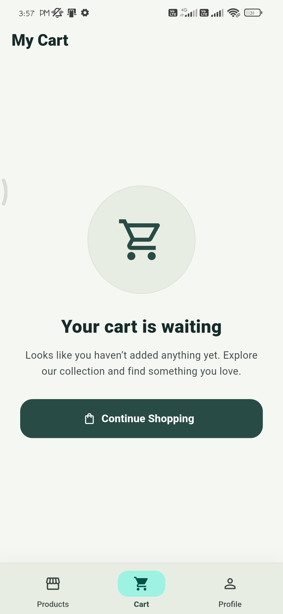
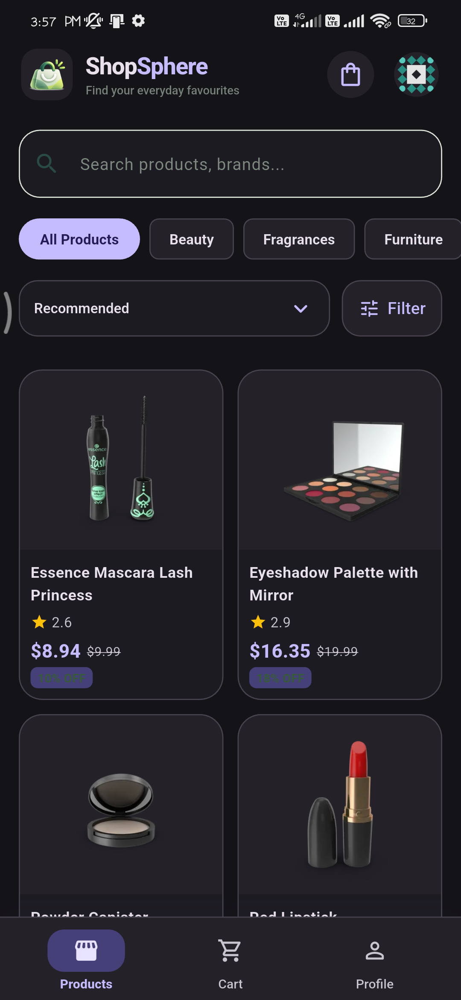
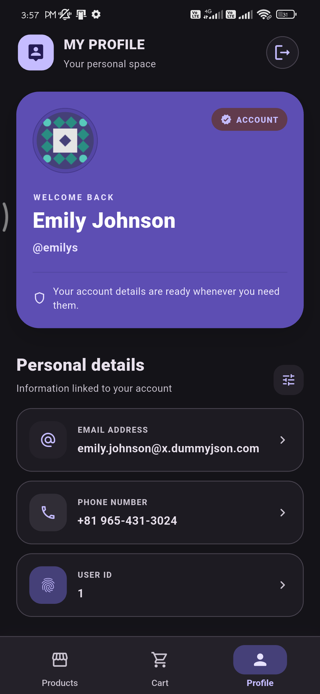
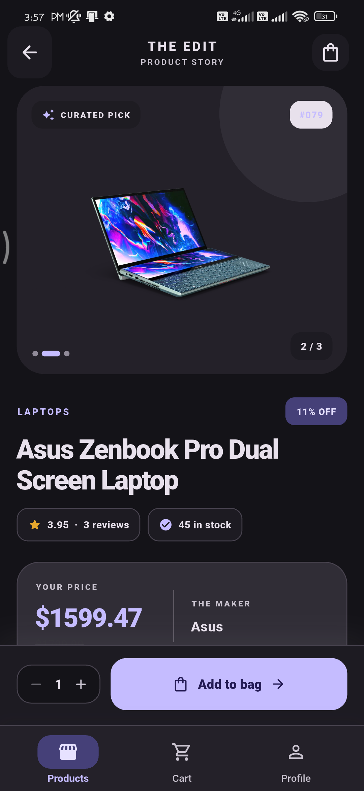
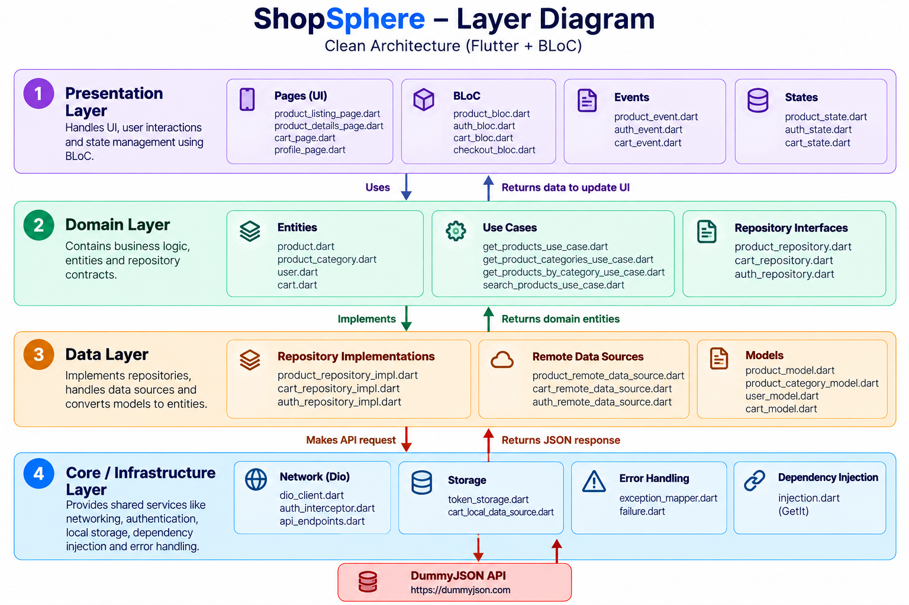
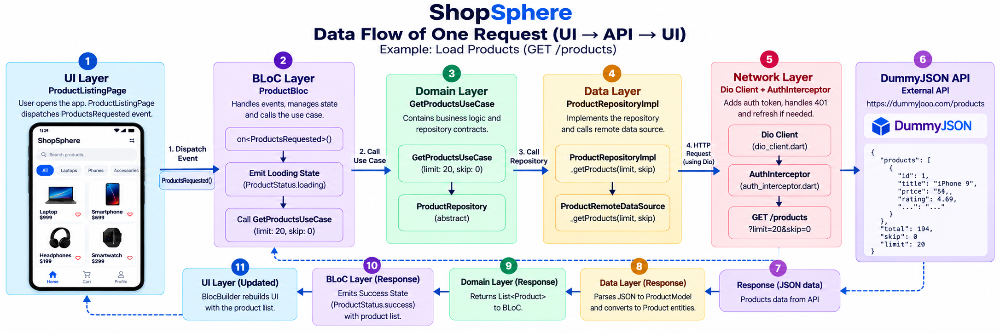

<div align="center">

# ShopSphere

### A responsive Flutter shopping experience built with BLoC and Clean Architecture

A mobile-first shopping catalogue featuring authentication, product discovery, product details, a persistent cart, checkout confirmation, profile management, and a persistent light/dark theme.

[](https://flutter.dev/)
[](https://dart.dev/)
[](https://bloclibrary.dev/)
[]()
[](https://github.com/Mayurs26/prosessed-flutter-assignment)

[**Download APK**](https://github.com/Mayurs26/prosessed-flutter-assignment/releases/tag/v1.0.0) ·
[**Demo & Screenshots**](https://drive.google.com/drive/folders/19Ampv2zLSNf5DXwCKnHY9D4iiArV4Ar2?usp=sharing) ·
[**Portfolio**](https://mayurportfolio-eight.vercel.app/)

</div>

---

## Table of Contents

- [Overview](#overview)
- [Screenshots](#screenshots)
- [Features](#features)
- [Tech Stack](#tech-stack)
- [Architecture](#architecture)
- [State Management](#state-management)
- [Error Handling](#error-handling)
- [Getting Started](#getting-started)
- [Testing and Code Quality](#testing-and-code-quality)
- [Test Credentials](#test-credentials)
- [Assumptions and Trade-offs](#assumptions-and-trade-offs)
- [AI Tool Disclosure](#ai-tool-disclosure)
- [Author](#author)

## Overview

ShopSphere is a Flutter shopping-catalogue application created for the Prosessed Flutter assignment. It uses the [DummyJSON API](https://dummyjson.com/) for authentication and product data, with a feature-first Clean Architecture structure to keep presentation, domain, and data responsibilities separated.

The app is designed for phone and tablet layouts. It includes authentication and session restoration, product search and discovery, cart management with local persistence, checkout confirmation, profile access, recoverable network errors, and a persistent light/dark theme.

**Release:** [ShopSphere v1.0.0 APK](https://github.com/Mayurs26/prosessed-flutter-assignment/releases/tag/v1.0.0)

## Screenshots

Screenshots are grouped by device size to make the app easier to review. All paths below are relative to the repository root.

### Phone

<table>
  <tr>
    <td align="center" width="33%">
      <strong>Splash</strong><br>
      
    </td>
    <td align="center" width="33%">
      <strong>Login</strong><br>
      
    </td>
    <td align="center" width="33%">
      <strong>Product Listing</strong><br>
      
    </td>
  </tr>
  <tr>
    <td align="center">
      <strong>Product Details</strong><br>
      
    </td>
    <td align="center">
      <strong>Cart</strong><br>
      
    </td>
    <td align="center">
      <strong>Profile</strong><br>
      
    </td>
  </tr>
  <tr>
    <td align="center">
      <strong>Filtering</strong><br>
      
    </td>
    <td align="center">
      <strong>Checkout Success</strong><br>
      
    </td>
    <td align="center">
      <strong>Empty Cart</strong><br>
      
    </td>
  </tr>
</table>

#### Dark Theme

<table>
  <tr>
    <td align="center" width="33%">
      <strong>Products</strong><br>
      
    </td>
    <td align="center" width="33%">
      <strong>Profile</strong><br>
      
    </td>
    <td align="center" width="33%">
      <strong>Profile Details</strong><br>
      
    </td>
  </tr>
</table>

### Tablet

<table>
  <tr>
    <td align="center" width="33%">
      <strong>Login</strong><br>
      
    </td>
    <td align="center" width="33%">
      <strong>Product Listing</strong><br>
      
    </td>
    <td align="center" width="33%">
      <strong>Cart</strong><br>
      
    </td>
  </tr>
  <tr>
    <td align="center" width="33%">
      <strong>Profile</strong><br>
      
    </td>
  </tr>
</table>

## Features

### Must-have requirements

- [x] Splash screen with session restoration and login/home routing.
- [x] Login form validation, authentication feedback, and logout/session clearing.
- [x] Product listing with API-loaded categories, search, category filtering, sorting, pagination, pull-to-refresh, loading, and empty states.
- [x] Product details, quantity selection, and product error handling.
- [x] Cart item updates, quantity controls, totals, cart badge, and local cart persistence.
- [x] Checkout request using DummyJSON's `POST /carts/add`, success confirmation, and cart clearing after successful checkout.
- [x] Profile information loaded from the authenticated-user endpoint and expired-session handling.
- [x] User-friendly network and error states; airplane mode was used to check network-failure behaviour.
- [x] Responsive phone and tablet layouts, represented in the screenshots above.

### Bonus requirements

- [x] Persistent light/dark theme toggle.
- [x] GitHub Actions workflow for automated analysis and tests.
- [x] Unit and widget tests covering core utilities, repositories, BLoC state transitions, and app behaviour.
- [x] Automatic access-token refresh and retry flow.
- [x] Airplane-mode testing for network-failure behaviour.

### Not implemented

- [ ] Locally persisted wishlist/favourites.
- [ ] Offline product cache and a dedicated “You are offline” banner.
- [ ] English/Hindi localization.
- [ ] Hero animation between a product thumbnail and its details image.

> **Offline behaviour:** Airplane mode was used to verify network-error handling. Product caching for offline browsing and a dedicated offline banner are not implemented.

## Tech Stack

| Technology / package | Purpose |
|---|---|
| Flutter / Dart | Cross-platform UI and application code. |
| Material 3 | Consistent Material design components and theming. |
| `flutter_bloc` | Event-driven state management using BLoCs and states. |
| `equatable` | Value equality for events, states, and domain objects where used. |
| `dio` | HTTP requests to DummyJSON and network configuration. |
| `get_it` | Dependency registration and service resolution. |
| `go_router` | Declarative app routing and navigation. |
| `flutter_secure_storage` | Secure storage for authentication tokens. |
| `shared_preferences` | Local preferences, including the persistent theme choice; the cart local data source also uses local persistence. |
| `cached_network_image` | Network image loading and caching support in the UI. |
| `shimmer` | Loading placeholders. |
| `intl` | Formatting utilities. |
| `stream_transform` | Stream transformation utilities. |
| `bloc_test` | Testing BLoC event-to-state behaviour. |
| `mocktail` | Mocking and stubbing dependencies in tests. |
| `flutter_test` | Flutter unit and widget testing. |
| GitHub Actions | Continuous integration for analysis and tests. |

The Dart SDK constraint declared in `pubspec.yaml` is `^3.13.5`. The app version is `1.0.0+1`.

## Architecture

ShopSphere uses **feature-first Clean Architecture**. Features are separated into `presentation`, `domain`, and `data` layers, while shared infrastructure lives in `core/`.

### Layer diagram



### Folder structure

```text
lib/
├── app.dart
├── main.dart
├── core/
│   ├── di/
│   │   └── injection.dart
│   ├── error/
│   │   ├── exception_mapper.dart
│   │   └── failure.dart
│   ├── network/
│   │   ├── api_endpoints.dart
│   │   ├── auth_interceptor.dart
│   │   └── dio_client.dart
│   ├── routing/
│   │   ├── app_router.dart
│   │   └── main_navigation_shell.dart
│   ├── storage/
│   │   └── token_storage.dart
│   ├── theme/
│   │   ├── app_theme.dart
│   │   └── theme_controller.dart
│   └── utils/
└── features/
    ├── auth/
    │   ├── data/
    │   │   ├── datasources/
    │   │   │   └── auth_remote_data_source.dart
    │   │   ├── models/
    │   │   │   └── login_response_model.dart
    │   │   └── repositories/
    │   │       └── auth_repository_impl.dart
    │   ├── domain/
    │   │   ├── entities/
    │   │   │   └── auth_session.dart
    │   │   ├── repositories/
    │   │   │   └── auth_repository.dart
    │   │   └── usecases/
    │   │       ├── get_current_user_use_case.dart
    │   │       ├── login_use_case.dart
    │   │       └── logout_use_case.dart
    │   └── presentation/
    │       ├── bloc/
    │       │   ├── auth_bloc.dart
    │       │   ├── auth_event.dart
    │       │   └── auth_state.dart
    │       └── pages/
    │           ├── login_page.dart
    │           ├── profile_page.dart
    │           └── splash_page.dart
    ├── cart/
    │   ├── data/
    │   │   ├── datasources/
    │   │   │   ├── cart_local_data_source.dart
    │   │   │   └── cart_remote_data_source.dart
    │   │   ├── models/
    │   │   └── repositories/
    │   │       └── cart_repository_impl.dart
    │   ├── domain/
    │   │   ├── entities/
    │   │   │   └── cart_item.dart
    │   │   ├── repositories/
    │   │   │   └── cart_repository.dart
    │   │   └── usecases/
    │   │       └── checkout_use_case.dart
    │   └── presentation/
    │       ├── bloc/
    │       │   ├── cart_bloc.dart
    │       │   ├── cart_event.dart
    │       │   ├── cart_state.dart
    │       │   ├── checkout_bloc.dart
    │       │   ├── checkout_event.dart
    │       │   └── checkout_state.dart
    │       ├── cubit/
    │       └── pages/
    │           ├── cart_page.dart
    │           └── checkout_success_page.dart
    ├── checkout/
    │   ├── data/
    │   │   ├── datasources/
    │   │   └── repositories/
    │   ├── domain/
    │   │   ├── repositories/
    │   │   └── usecases/
    │   └── presentation/
    │       ├── bloc/
    │       └── pages/
    └── products/
        ├── data/
        │   ├── datasources/
        │   │   └── product_remote_data_source.dart
        │   ├── models/
        │   │   ├── product_category_model.dart
        │   │   └── product_model.dart
        │   └── repositories/
        │       └── product_repository_impl.dart
        ├── domain/
        │   ├── entities/
        │   │   ├── product.dart
        │   │   ├── product_category.dart
        │   │   └── product_review.dart
        │   ├── repositories/
        │   │   └── product_repository.dart
        │   └── usecases/
        │       ├── get_products_by_category_use_case.dart
        │       ├── get_products_use_case.dart
        │       ├── get_product_by_id_use_case.dart
        │       ├── get_product_categories_use_case.dart
        │       └── search_products_use_case.dart
        └── presentation/
            ├── bloc/
            │   ├── product_bloc.dart
            │   ├── product_event.dart
            │   └── product_state.dart
            └── pages/
                ├── product_details_page.dart
                └── product_listing_page.dart
```

### Layer responsibilities

- **Presentation:** Pages and widgets display the UI. BLoCs receive events and emit states.
- **Domain:** Entities, repository contracts, and use cases define core application rules and abstractions.
- **Data:** Data sources communicate with remote APIs or local storage. Models parse external data, and repository implementations fulfil domain contracts.
- **Core:** Shared dependency injection, Dio configuration and interceptors, routing, secure token storage, theme configuration, and error mapping.

### Data flow: one request (UI → API → UI)

Example: loading the product list.



1. The product listing page triggers a product-loading event.
2. `ProductBloc` emits a loading state and invokes the relevant use case.
3. The use case calls the domain repository contract.
4. The repository implementation requests data from the remote data source.
5. The data source uses Dio to call the DummyJSON products endpoint.
6. The response is parsed into data models and mapped to domain entities.
7. The result returns through the use case to `ProductBloc`.
8. The BLoC emits a success or failure state, and the UI rebuilds to show the products or a recoverable error message.

## State Management

ShopSphere uses **BLoC (Business Logic Component)** through `flutter_bloc`.

- UI interactions are represented as events.
- BLoCs process events and emit states such as loading, success, and failure.
- Widgets react to state changes rather than owning the feature's business logic.
- Authentication, products, cart, and checkout have dedicated BLoC event/state files.
- `bloc_test` and `mocktail` are used to test state transitions and isolate dependencies.

This approach keeps UI rendering separate from application behaviour and makes key flows easier to test.

## Error Handling

Network and application errors are mapped into user-facing failure states rather than being treated as successful responses.

- Dio/network exceptions are handled by the data/repository and error-mapping flow.
- Feature BLoCs emit failure states when operations fail.
- The UI can show recoverable feedback for invalid credentials, expired sessions, missing products, and network failures.
- Airplane-mode testing was used to check the network-error path.

## Getting Started

### Prerequisites

- Flutter SDK compatible with the Dart constraint in `pubspec.yaml` (`^3.13.5`).
- Android Studio or VS Code with Flutter and Dart tooling.
- An Android emulator or physical Android device.
- Git.

Check the installed tools:

```bash
flutter --version
dart --version
flutter doctor
```

### Clone the repository

```bash
git clone https://github.com/Mayurs26/prosessed-flutter-assignment.git
cd prosessed-flutter-assignment
```

### Install dependencies

```bash
flutter pub get
```

### Run the app

```bash
flutter run
```

### Run static analysis

```bash
flutter analyze
```

### Run tests

```bash
flutter test
```

### Run tests with coverage

```bash
flutter test --coverage
```

The coverage command writes `coverage/lcov.info`. To calculate a percentage, use an LCOV-compatible report tool or your IDE's coverage viewer; do not infer a coverage percentage from the test count alone.

### Build a release APK

```bash
flutter build apk --release
```

Default output:

```text
build/app/outputs/flutter-apk/app-release.apk
```

The published assignment APK is available from the [GitHub v1.0.0 release](https://github.com/Mayurs26/prosessed-flutter-assignment/releases/tag/v1.0.0). You can also access the [Drive folder](https://drive.google.com/drive/folders/19Ampv2zLSNf5DXwCKnHY9D4iiArV4Ar2?usp=sharing).

## Testing and Code Quality

The test suite includes unit and widget tests for authentication, product repositories, product BLoC behaviour, error handling, and app launch behaviour.

**Latest provided verification output:**

| Check | Result |
|---|---|
| `flutter test` | **147 tests passed** |
| `flutter test --coverage` | **147 tests passed** |
| `flutter analyze` | **No issues found** |

The analysis result above was reported from the local project terminal. Run the commands again after making changes to verify the current checkout.

GitHub Actions is configured to automate analysis and test checks. See the repository's workflow files under `.github/workflows/`.

## Test Credentials

DummyJSON provides sample authentication accounts. One commonly documented sample account is:

- **Username:** `emilys`
- **Password:** `emilyspass`

These are public API sample credentials, not private application credentials. If the API changes or these credentials stop working, consult the [DummyJSON authentication documentation](https://dummyjson.com/docs/auth).

## Assumptions and Trade-offs

- **API:** DummyJSON is used as a demonstration API. Its cart endpoint simulates checkout behaviour; it does not represent a real payment or fulfilment system.
- **Authentication:** Access and refresh tokens are stored using secure storage. Token refresh and retry are implemented in the network/authentication flow.
- **Cart persistence:** Cart state is persisted locally for continuity between app sessions.
- **Offline behaviour:** Network failure feedback is supported and was checked with airplane mode. Offline product-list caching and a dedicated offline banner are not implemented.
- **Scope:** Wishlist persistence, localization, and the product-image Hero animation are not implemented.
- **Architecture:** Feature-first Clean Architecture adds separation and testability, at the cost of more files and abstractions than a small single-screen app.

## AI Tool Disclosure

**ChatGPT was used as a development assistant.** I made the product decisions, defined the application logic and requirements, and created the UI direction and visual design. I also used ChatGPT to help generate and refine some code, improve code structure and formatting, explain errors, and assist with documentation and testing workflows. I reviewed and integrated the suggestions into the project and ran the reported analysis and test commands.

The final implementation reflects my design choices and project decisions, with AI assistance used as a supporting development tool.

## Author

**Mayur Sonawane**

- Email: [mayurr.2609@gmail.com](mailto:mayurr.2609@gmail.com)
- LinkedIn: [mayur-sonawane](https://www.linkedin.com/in/mayur-sonawane-)
- GitHub: [Mayurs26](https://github.com/Mayurs26)
- Portfolio: [mayurportfolio-eight.vercel.app](https://mayurportfolio-eight.vercel.app/)

---

<div align="center">

Built with Flutter, BLoC, and care for clean architecture.

</div>
