# 🛍️ ShopSphere — Flutter E-Commerce App

ShopSphere is a Flutter e-commerce catalogue app built for the **Prosessed Flutter Developer Intern technical assignment**. It uses the DummyJSON REST API and demonstrates authentication, product discovery, cart management, responsive UI, structured state management, and automated testing.

> **Submission links**
>
> - **GitHub repository:** https://github.com/Mayurs26/prosessed-flutter-assignment
> - **Release APK:** _Add the direct GitHub Release APK URL after publishing `v1.0.0`._
> - **Demo video / Google Drive:** _Add the shareable Google Drive folder or demo URL before submission._
>
> Do not leave the placeholders above in the final submission. Verify every link in a private/incognito browser window.

---

## 1. Screenshots

The screenshots below are grouped by device so reviewers can compare the phone and tablet experiences at a glance. Images are displayed side by side instead of as a long vertical list.

### 📱 Phone screenshots

<table>
  <tr>
    <td align="center" width="33%">
      <strong>Splash</strong><br/>
      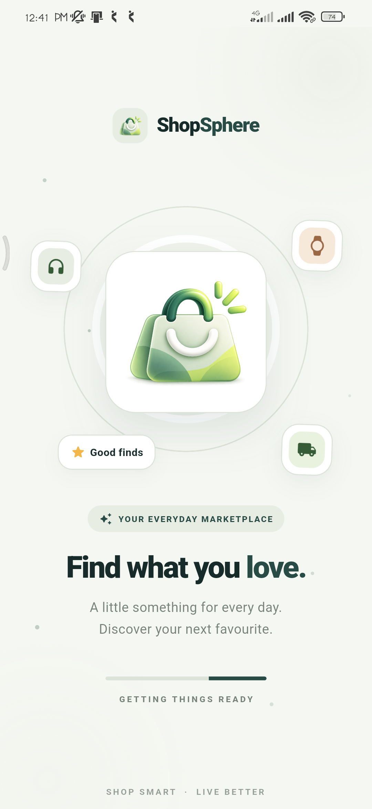
    </td>
    <td align="center" width="33%">
      <strong>Login</strong><br/>
      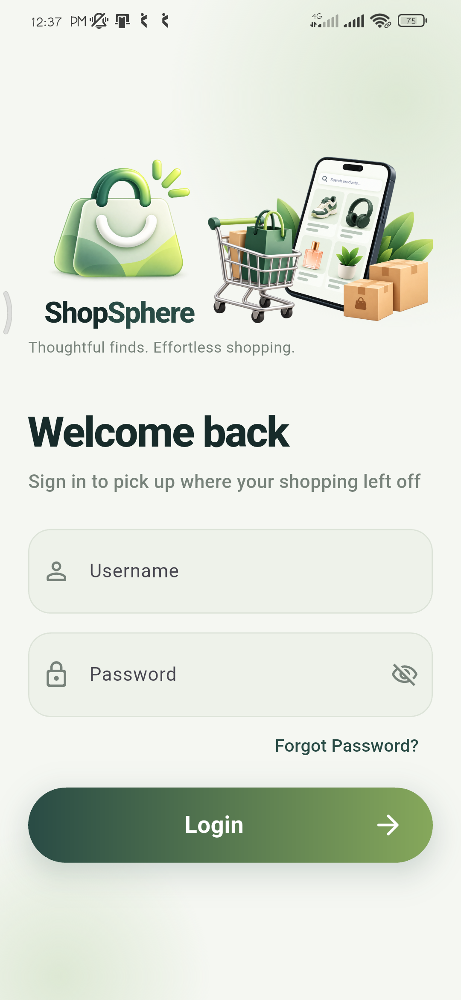
    </td>
    <td align="center" width="33%">
      <strong>Products</strong><br/>
      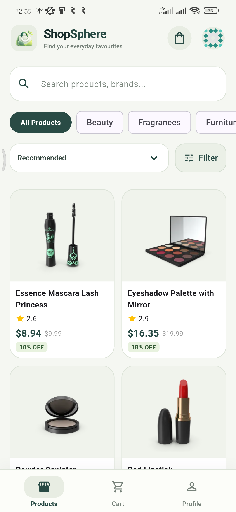
    </td>
  </tr>
  <tr>
    <td align="center" width="33%">
      <strong>Product details</strong><br/>
      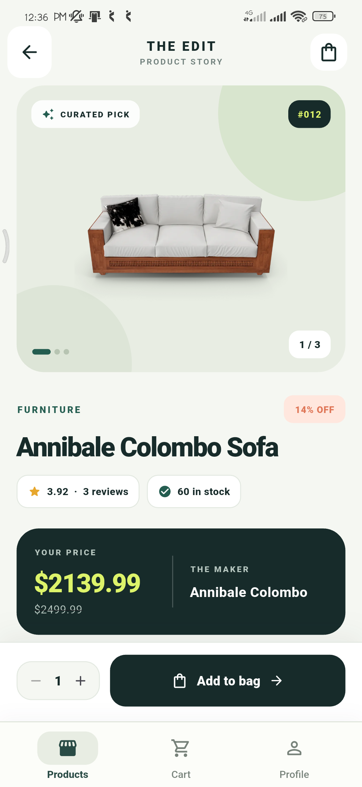
    </td>
    <td align="center" width="33%">
      <strong>Cart</strong><br/>
      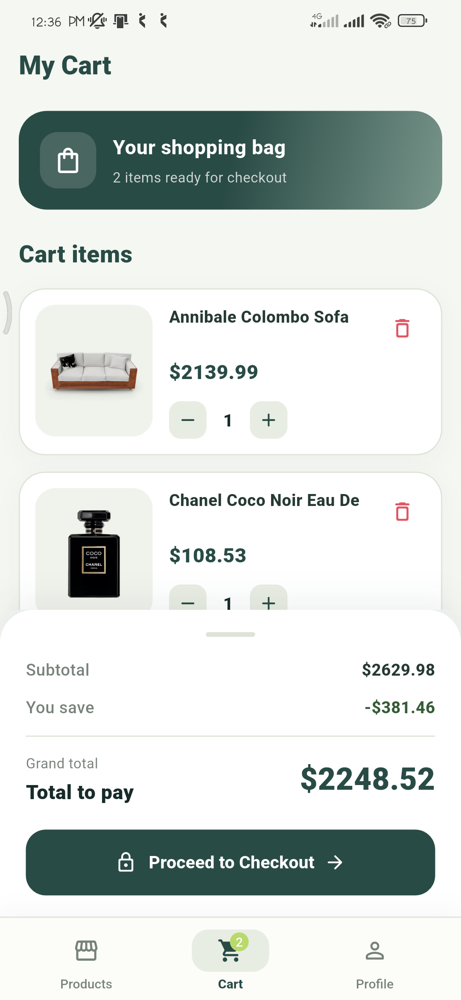
    </td>
    <td align="center" width="33%">
      <strong>Profile</strong><br/>
      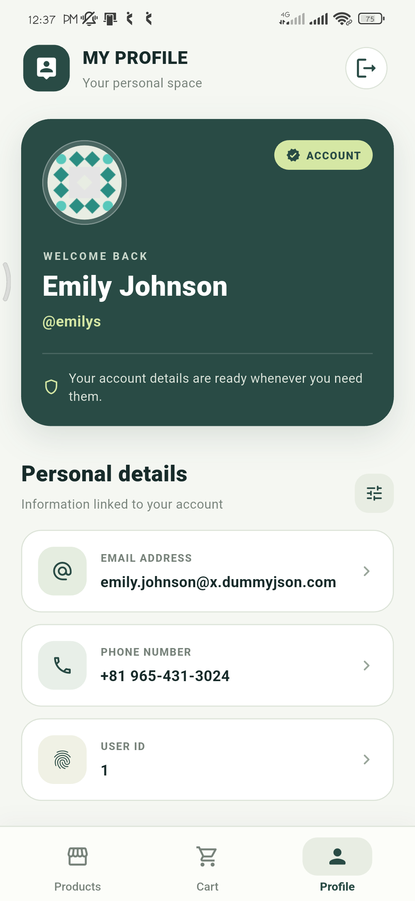
    </td>
  </tr>
  <tr>
    <td align="center" width="33%">
      <strong>Checkout success</strong><br/>
      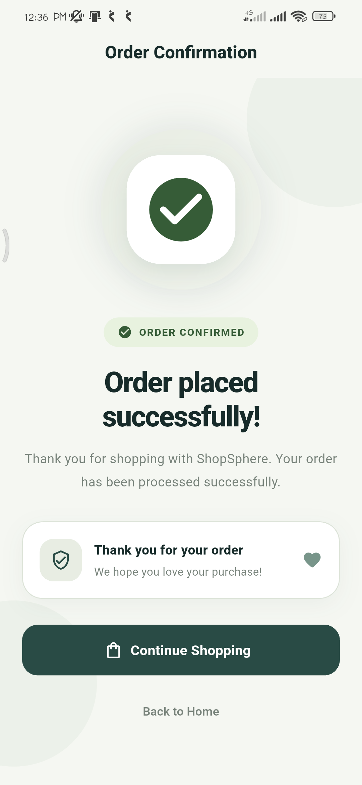
    </td>
    <td align="center" width="33%">
      <strong>Filter</strong><br/>
      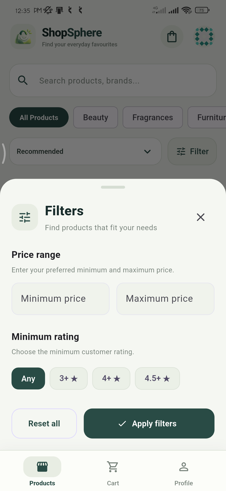
    </td>
  </tr>
</table>

### 💻 Tablet screenshots

<table>
  <tr>
    <td align="center" width="50%">
      <strong>Login — tablet</strong><br/>
      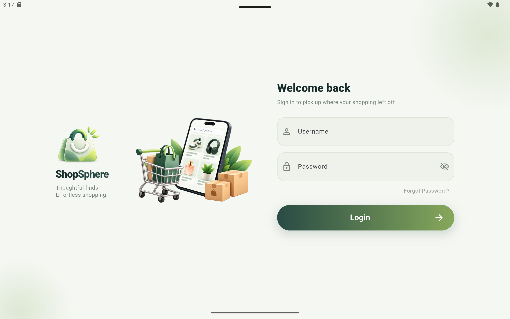
    </td>
    <td align="center" width="50%">
      <strong>Products — tablet</strong><br/>
      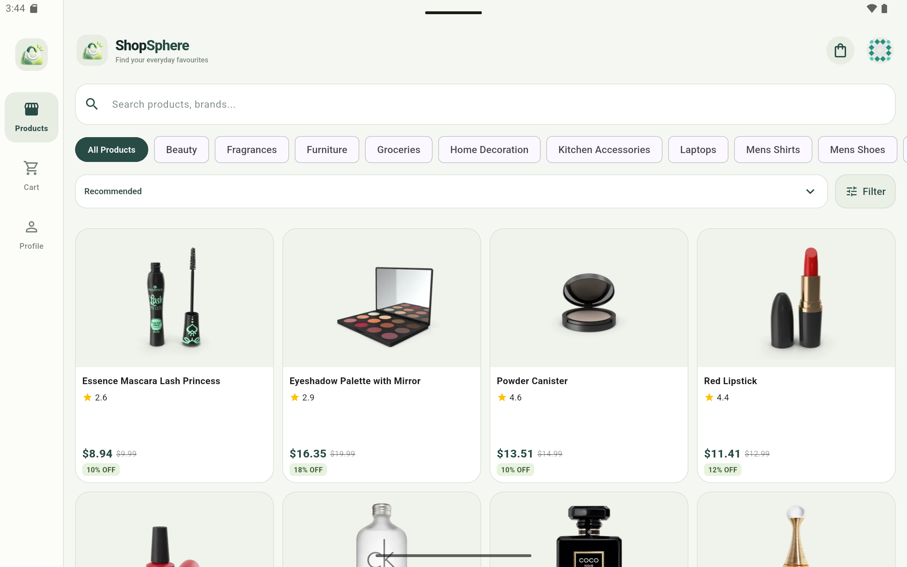
    </td>
  </tr>
  <tr>
    <td align="center" width="50%">
      <strong>Cart — tablet</strong><br/>
      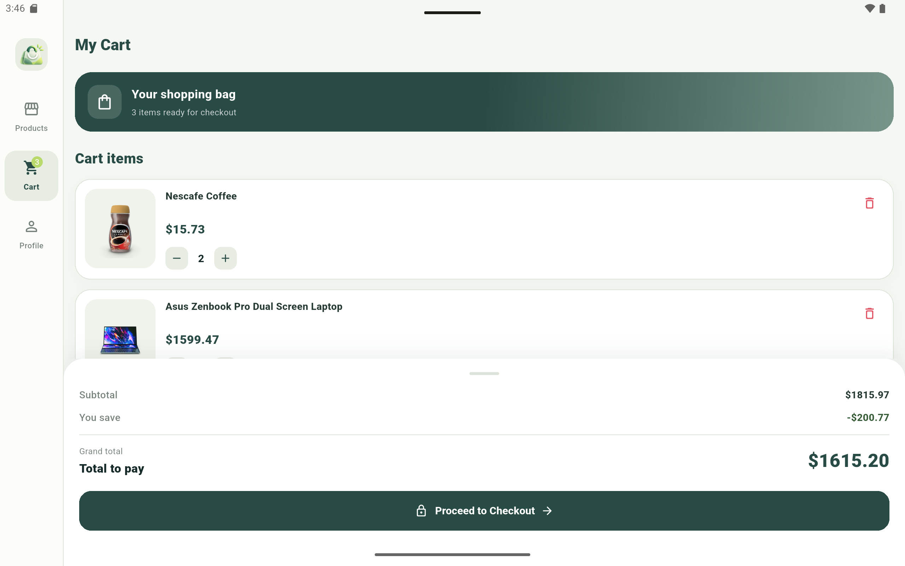
    </td>
    <td align="center" width="50%">
      <strong>Profile — tablet</strong><br/>
      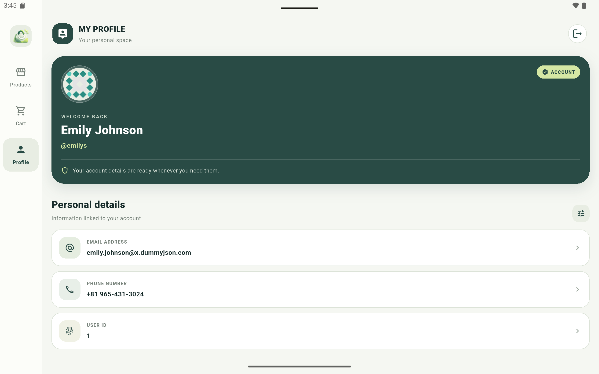
    </td>
    <td align="center" width="33%">
      <strong>Category filter</strong><br/>
      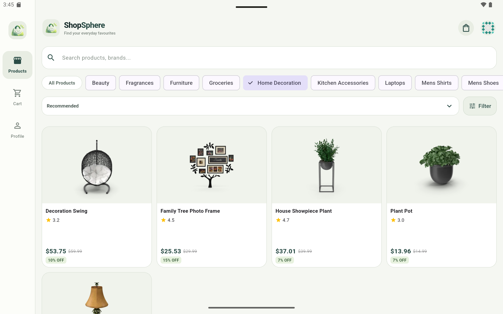
    </td>
  </tr>
</table>

> **Before submission:** The assignment requires at least four phone screenshots and two tablet/landscape screenshots. Confirm that the tablet captures genuinely show the intended tablet/landscape layouts; recapture in landscape if needed. GitHub renders these as an HTML image grid, so the layout stays compact and easy to scan.

---

## 2. Features

The checklist below distinguishes the intended assignment scope from features whose completion must be verified against the current code and a manual run. Mark an item complete only after validating its implementation.

### Must-have requirements

#### Splash and authentication

- [x] Login UI with username and password fields.
- [x] Inline form validation and password visibility toggle.
- [x] Loading/authentication state handling.
- [ ] Verify splash checks the stored session and routes to Home or Login.
- [ ] Verify `POST /auth/login` stores both access and refresh tokens securely.
- [ ] Verify invalid credentials show a clear inline message.
- [ ] Verify logout clears tokens and local session.

#### Home — product list

- [x] Product listing UI and product discovery.
- [x] Search and category-filtering UI.
- [ ] Verify infinite-scroll pagination uses `limit` and `skip` with page size 20.
- [ ] Verify pull-to-refresh.
- [ ] Verify category chips are loaded from the API.
- [ ] Verify search debounce is approximately 400 ms.
- [ ] Verify sort by price ascending/descending, rating, and title.
- [ ] Verify shimmer/skeleton loading and a dedicated no-results state.
- [ ] Verify compact, medium, and expanded layouts against the assignment breakpoints.

#### Product details

- [x] Product details screen.
- [ ] Verify image carousel and page indicator.
- [ ] Verify nullable brand, discounted price, rating, stock status, description, and customer reviews.
- [ ] Verify quantity selector and Add to Cart behaviour.
- [ ] Verify Add to Cart is disabled for out-of-stock products.
- [ ] Verify `/products/9999` displays a recoverable “Product not found” state.

#### Cart and checkout

- [x] Cart screen and local cart persistence are part of the project scope.
- [ ] Verify add/remove/update quantity and prevent invalid quantities.
- [ ] Verify subtotal, discount, and grand total calculations.
- [ ] Verify cart persists after app restart.
- [ ] Verify navigation/app-bar cart badge updates in real time.
- [ ] Verify Place Order calls `POST /carts/add`, shows confirmation, and clears the cart only on success.

#### Profile

- [x] Profile screen.
- [ ] Verify profile is fetched from `GET /auth/me` and displays avatar, name, email, and phone.
- [ ] Verify HTTP 401 / refresh-token 403 behaviour signs the user out with an explanatory message.

### Bonus requirements

- [ ] Automatic access-token refresh and retry using an interceptor — verify manually before claiming complete.
- [ ] Persistent light/dark theme toggle.
- [ ] Locally persisted wishlist/favourites.
- [ ] Offline product cache and offline banner.
- [ ] Widget or golden tests.
- [ ] English/Hindi localization.
- [ ] GitHub Actions CI running `flutter analyze` and `flutter test`.
- [ ] Hero animation between product thumbnail and details image.

### Known verification gaps

This README does not claim unchecked requirements are complete. Before submission, update the checklists based on code inspection and manual testing, and list any remaining limitations here.

---

## 3. Tech stack

### SDK versions

Record the **actual versions from the machine used for the final verification**. Run `flutter --version` and replace these placeholders; do not guess SDK versions.

- **Flutter:** _Replace with output from `flutter --version`_
- **Dart:** _Replace with output from `flutter --version`_

### Packages

| Package / technology | Why it is used |
|---|---|
| Flutter / Dart | Cross-platform UI and application logic. |
| `flutter_bloc` | Explicit, predictable UI state transitions using BLoC/Cubit. |
| `equatable` | Value equality for states and events, reducing boilerplate. |
| `dio` | Configurable HTTP client, interceptors, and request error handling. |
| `get_it` | Dependency injection/service location so UI does not construct repositories directly. |
| `go_router` | Declarative route configuration and navigation. |
| `flutter_secure_storage` | Secure storage for authentication tokens. |
| `shared_preferences` | Lightweight local preferences/persistence where appropriate. |
| `cached_network_image` | Network image caching and image-loading placeholders. |
| `shimmer` | Loading skeletons/placeholders. |
| `intl` | Formatting utilities such as currency/date formatting. |
| `bloc_test` | Testing BLoC/Cubit state transitions. |
| `mocktail` | Mocking dependencies in automated tests. |
| DummyJSON | Public sample REST API required by the assignment. |

Confirm package names and versions against `pubspec.yaml` before release. Avoid adding packages to this table unless they are actually used by the app.

---

## 4. Architecture

ShopSphere uses a feature-first structure with presentation, domain, and data layers. The tree below is a high-level guide; the current repository is the source of truth for exact files.

```text
lib/
├── core/
│   ├── di/
│   ├── error/
│   ├── network/
│   ├── routing/
│   ├── storage/
│   └── theme/
├── features/
│   ├── auth/
│   │   ├── data/
│   │   ├── domain/
│   │   └── presentation/
│   ├── products/
│   │   ├── data/
│   │   ├── domain/
│   │   └── presentation/
│   └── cart/
│       ├── data/
│       ├── domain/
│       └── presentation/
└── main.dart

test/
├── core/
├── features/
└── widget_test.dart
```

### Layer responsibilities

- **Presentation:** Screens, reusable UI, and BLoC/Cubit state handling.
- **Domain:** Business rules, entities, repository contracts, and use cases where implemented.
- **Data:** API/local data sources, DTO/model parsing, and repository implementations.
- **Core:** Shared networking, dependency injection, routing, storage, theme, and failures.

### Example request flow: loading products

```text
Products screen
    ↓ user action / BLoC event
Products BLoC or Cubit
    ↓
Get-products use case (if used by this feature)
    ↓
Products repository contract
    ↓
Repository implementation / remote data source
    ↓
Dio client → DummyJSON API
    ↓
JSON response → model/DTO → repository result
    ↓
BLoC/Cubit emits success, empty, or failure state
    ↓
UI renders products or a recoverable state
```

The exact path may differ by feature; keep this diagram aligned with the current implementation when making final edits.

---

## 5. State management

ShopSphere uses **`flutter_bloc` (BLoC/Cubit)** for predictable, explicit state management.

BLoC/Cubit makes loading, success, empty, and failure states observable instead of scattering asynchronous business logic across widgets. It also makes important transitions testable with `bloc_test` and mocked dependencies. The trade-off is additional classes and boilerplate compared with simpler local state; for an assignment focused on testability and separation of concerns, that structure is intentional.

---

## 6. API integration and error handling

**Base URL:** `https://dummyjson.com`

| Method | Endpoint | Purpose |
|---|---|---|
| `POST` | `/auth/login` | Sign in and receive tokens/user data. |
| `GET` | `/auth/me` | Retrieve the signed-in user. |
| `POST` | `/auth/refresh` | Request refreshed access credentials. |
| `GET` | `/products?limit=20&skip=0` | Paginated product list. |
| `GET` | `/products?sortBy=price&order=asc` | Example server-side sort. |
| `GET` | `/products/search?q=phone` | Search products. |
| `GET` | `/products/categories` | Retrieve category objects. |
| `GET` | `/products/category/{slug}` | Retrieve products in a category. |
| `GET` | `/products/{id}` | Retrieve product details. |
| `POST` | `/carts/add` | Simulate cart/order creation. |

API reference: [DummyJSON documentation](https://dummyjson.com/docs).

### Error-handling approach

The app should translate low-level network/API errors into user-facing states rather than showing raw exceptions. Each network-driven screen should provide loading, success, empty, and error states, with a retry path where appropriate.

Before release, verify these assignment scenarios and record the actual observed result:

| Scenario | How to test | Expected behaviour |
|---|---|---|
| Server error | `GET /http/500` | Friendly error and Retry; no crash or raw stack trace. |
| Missing product | `GET /products/9999` | “Product not found” state and a way back. |
| Slow network | `GET /products?delay=3000` | Loader remains visible; timeout/error is handled. |
| Invalid login | Submit an incorrect password | Inline “Invalid username or password” message. |
| Invalid/expired session | Call `/auth/me` with invalid/expired credentials | Refresh/retry if implemented, otherwise sign out with a message. |
| Invalid refresh token | `POST /auth/refresh` with an invalid token | Sign out and explain that the session expired. |
| No internet | Enable airplane mode | Offline/error message and retry; cached content only if implemented. |

Do not describe an error path as verified until it has been exercised in the running app.

---

## 7. Getting started

### Prerequisites

- Flutter SDK and the Dart SDK bundled with it.
- Git.
- Android Studio or VS Code with Flutter tooling.
- Android emulator or Android device; other Flutter-supported targets may be available.

### 1. Clone the repository

```bash
git clone https://github.com/Mayurs26/prosessed-flutter-assignment.git
cd prosessed-flutter-assignment
```

### 2. Install dependencies

```bash
flutter pub get
```

### 3. Code generation

No code-generation command is listed here because the current README does not establish that generated code is required. Inspect `pubspec.yaml` and the repository for `build_runner`, Freezed, or JSON serialization generators. If the project uses them, document and run the exact required command here.

### 4. Check the environment and devices

```bash
flutter doctor
flutter --version
flutter devices
```

### 5. Run the app

```bash
flutter run
```

To select a particular device:

```bash
flutter run -d <device_id>
```

### 6. Analyze and format

```bash
flutter analyze
dart format --output=none --set-exit-if-changed lib test
```

### 7. Build the release APK

```bash
flutter build apk --release
```

The default output is:

```text
build/app/outputs/flutter-apk/app-release.apk
```

Rename a copy for submission using the required format:

```text
ShopSphere_Mayur_Sonawane_v1.0.0.apk
```

Install and smoke-test the release APK on an Android 8.0 (API 26) or newer device before uploading it. Attach the APK to a GitHub Release tagged `v1.0.0`.

---

## 8. Testing

Run all automated tests:

```bash
flutter test --reporter expanded
```

Run the login page tests:

```bash
flutter test test/features/auth/presentation/pages/login_page_test.dart --reporter expanded
```

Generate coverage data:

```bash
flutter test --coverage
```

Coverage output is written to `coverage/lcov.info`. To report a coverage percentage, calculate it from the generated file and update the summary below. Do not treat a generated coverage file as proof of a particular percentage.

### Recorded test results

- **48 tests passed** in the previously recorded complete test-suite run.
- **5 login page tests passed** in the previously recorded login-page test run.
- These are historical results, not a guarantee that the latest code still passes. Re-run the commands above after the final code change and replace these figures with the latest output.
- **Current line coverage:** _Run `flutter test --coverage`, calculate the line coverage, and enter the actual percentage here._
- **Test scope:** The assignment requires at least 15 meaningful tests across repository success/server/network failure paths, use cases, BLoC/Cubit state transitions, and JSON model parsing. Audit the current test files and list the actual coverage of these categories before submission.

---

## 9. Test credentials

Use the credentials specified by the assignment for DummyJSON:

```text
Username: emilys
Password: emilyspass
```

DummyJSON is a demonstration API. Cart/order write operations are simulated and do not create a persistent real-world order on the server. The app must persist its own cart locally to satisfy the assignment requirement.

---

## 10. Assumptions and trade-offs

- **Backend:** DummyJSON is the required API; no custom backend is part of this assignment.
- **Simulated checkout:** `POST /carts/add` returns a simulated response, so the client must not imply that a real order was placed with a merchant.
- **State management:** BLoC/Cubit is used for explicit state transitions and testability, at the cost of more structure and boilerplate.
- **Local persistence:** Local storage is required for cart survival across restarts; verify the exact storage implementation in the current code.
- **Scope honesty:** Unchecked feature items above are verification tasks, not claims of completion. Any incomplete must-have feature should be documented clearly before submission.
- **Future improvements:** Add integration tests for full user journeys, improve measured coverage, validate accessibility/font scaling, and verify phone/tablet portrait and landscape layouts and release behaviour on a physical device.

### AI tool disclosure

AI assistance was used to help review the assignment requirements, organize README documentation, and identify verification gaps. The submitted code should be reviewed and understood by the author, who is responsible for validating the implementation and test results.

Edit this disclosure if your actual use of AI tools differs. The assignment explicitly asks candidates to disclose AI use.

---

## 11. Author

**Mayur Sonawane**  
Flutter Developer | MCA Graduate

- **GitHub:** [Mayurs26](https://github.com/Mayurs26)
- **Portfolio:** [mayurportfolio-eight.vercel.app](https://mayurportfolio-eight.vercel.app)
- **Email:** [mayursonawane4631@gmail.com](mailto:mayursonawane4631@gmail.com)
- **LinkedIn:** _Add your public LinkedIn profile URL before submission._

---

## 12. Submission checklist

Before submitting, confirm every item:

- [ ] Update Flutter and Dart versions from `flutter --version`.
- [ ] Run `flutter analyze` and resolve all issues.
- [ ] Run the formatter check and `flutter test`; record the latest results.
- [ ] Calculate and record actual line coverage.
- [ ] Manually test all must-have flows and the error scenarios above.
- [ ] Test on phone and tablet in portrait and landscape, including 1.3× system font scaling; confirm no overflow.
- [ ] Keep at least 20 meaningful, atomic Conventional Commits.
- [ ] Ensure `.gitignore` excludes build output, `.dart_tool/`, IDE files, secrets, and signing keys.
- [ ] Ensure at least four phone screenshots and two tablet/landscape screenshots are present and correctly displayed in this README.
- [ ] Build and install the release APK; name it `ShopSphere_Mayur_Sonawane_v1.0.0.apk`.
- [ ] Publish GitHub Release `v1.0.0` and attach the APK.
- [ ] Create a Google Drive folder named `Prosessed_Flutter_Mayur_Sonawane` containing the APK, a 2–4 minute demo video, and screenshots.
- [ ] Set the Drive folder to **Anyone with the link — Viewer**.
- [ ] Add the final APK and demo/Drive URLs near the top of this README.
- [ ] Open the GitHub repository, APK, and Drive links in an incognito/private browser window.
- [ ] Submit before **Wednesday, 21 October 2026, 11:59 PM IST**.

---

*Built with Flutter. Prepared for the Prosessed Flutter Developer Intern assignment.*
